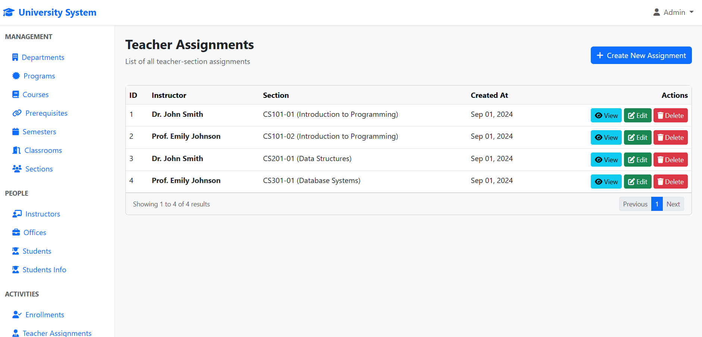
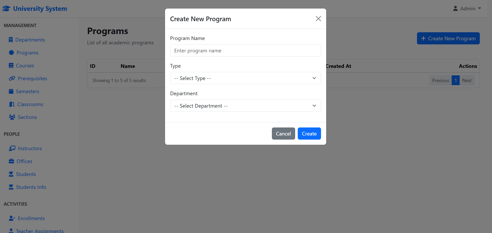

# University Management System

A Laravel academic-management development project combining relational database design, Blade administration pages, JWT API authentication, and a React Flow database-schema visualizer.

The repository demonstrates academic entities and selected management workflows. Some screens remain sample-data views, and the application is not presented as a complete university ERP or production-ready service.

## Start with the correct application tree

The repository contains two Laravel trees:

| Path | Checked state |
| --- | --- |
| Repository root | Contains manifests, models, controllers, and migrations, but `routes/web.php` and `routes/api.php` are empty. |
| `db_demo/` | Contains the academic web/API routes, Blade screens, React schema visualizer, migrations, and seeders. This is the documented local entry point. |

Run the following commands from `db_demo/`, not the repository root. The two trees are not interchangeable; this documentation update does not reorganize or modify them.

## Verified implementation

- Laravel 12/PHP application with Eloquent models, migrations, and Arabic demo data seeders.
- Department hierarchy, programs/courses, semesters/sections, instructors, and student relationships.
- Department list/create/update/delete routes and student list/create/image-update code paths.
- Blade pages for academic administration; several other management pages display static sample data rather than complete database-backed CRUD.
- Session-based web login/registration and JWT-based API login/registration/logout.
- Authenticated department retrieval endpoints; a public schema-inspection endpoint.
- A SQL `student_info_view` joining student, program, and parent/child department information.
- React Flow schema visualization using table, column, and foreign-key metadata queried from MySQL.
- Student image handling through Spatie Media Library.

## Technology stack

PHP 8.2+ · Laravel 12 · Eloquent ORM · MySQL · Blade · `tymon/jwt-auth` 2 · Spatie Media Library 11 · React 19 · React Router 7 · React Flow 11 · Tailwind CSS 3 · Vite 7

The existing starter documentation’s Laravel 11/React 18 version labels do not match the current manifests.

## Architecture

```text
Blade administration → web routes → controllers → Eloquent → MySQL
API clients → API routes / JWT guard → API controllers → Eloquent
React Flow visualizer → /api/schema → database metadata queries
Student information page → StudentInfo model → SQL view
```

Source entry points under `db_demo/`:

- `routes/web.php`, `routes/api.php`: implemented route surface.
- `app/Http/Controllers/`: academic/web controllers and API controllers.
- `app/Models/`: entity relationships, JWT subject, media handling, and SQL-view model.
- `database/migrations/`, `database/seeders/`: schema and local demo data.
- `resources/views/`: Blade screens.
- `resources/js/components/SchemaVisualizer.jsx`: database visualization.

## Database design

The migrations define **14 academic tables**, in addition to users, media, and Laravel infrastructure tables. This is a schema count, not a claim that every entity has a complete application workflow.

| Academic area | Tables and relationships |
| --- | --- |
| Organization | `departments` has a nullable self-reference; departments contain `programs`. |
| Curriculum | Programs contain `courses`; `prerequisites` links courses to prerequisite courses. |
| Delivery | `sections` references courses, `semesters`, and `classrooms`. |
| Teaching | `instructors` references departments and `offices`; `teachers_sections` connects instructors and sections. |
| Learners | `students` references programs and optionally users; `enrollment` connects students and sections. |
| Assessment | `assignments` belongs to sections; `submisions` connects assignments and students. The table spelling is preserved from the source. |

`student_info_view` is an additional SQL view, not one of the 14 academic tables. It combines student contact fields with program and department hierarchy names. The schema visualizer uses MySQL-specific metadata queries; SQLite is not an equivalent setup for this application.

## Academic workflows and current scope

- **Departments:** create/update/delete actions are implemented, but the list action currently stops at a `dd($user)` debug statement before rendering. The workflow requires a separate source-code fix before it can be described as fully usable.
- **Students:** list records, create students linked to programs, and manage student images. The current update action focuses on images; the resource route declaration does not mean every resource action is implemented.
- **Programs/student information:** program listing uses the signed-in user’s role; the student information page expects a user linked to a student record.
- **Enrollment/assessment:** relationships and seed data exist, but their page controllers currently return sample-data views. Do not infer implemented enrollment rules, grading, or submission processing from the schema alone.
- **Schema exploration:** `/schema` loads the React visualizer, which requests `/api/schema` for tables, columns, and foreign-key relationships.

## Authentication and API

Web authentication uses Laravel sessions. API authentication uses the configured `api` JWT guard, a `JWTSubject` user model, and token creation/invalidation calls.

| Method | Endpoint | Checked behavior |
| --- | --- | --- |
| GET | `/api/schema` | Public; database structure metadata |
| POST | `/api/register` | Registration and JWT creation |
| POST | `/api/login` | Credential validation and JWT response |
| POST | `/api/logout` | `auth:api`; token invalidation |
| GET | `/api/department/{dep}` | `auth:api`; department JSON |
| GET | `/api/department/edit/{dep}` | `auth:api`; JSON retrieval despite the route name; does not update a record |

Send `Authorization: Bearer <token>` to JWT-protected routes. JWT implementation does not establish comprehensive role enforcement: web routes are not consistently guarded, and web registration accepts an admin role. Keep the application local until a separate security review addresses these boundaries.

## Local installation and database setup

**Setup status:** commands were checked against the `db_demo/` manifests, configuration, routes, and migrations, but not executed in a clean environment. This is an untested local setup guide, not a verified deployment procedure.

Requirements: PHP compatible with `composer.lock` (manifest minimum 8.2), Composer 2, MySQL, PHP PDO MySQL, Node.js 22.12+ or a compatible newer LTS release, and npm. Composer reports additional extension requirements.

```bash
git clone https://github.com/mustafa-baaj1/University_system.git
cd University_system/db_demo
composer install
php -r "file_exists('.env') || copy('.env.example', '.env');"
php artisan key:generate
php artisan jwt:secret
npm ci
```

Create an empty, disposable MySQL database. In your local `.env`, keep `DB_CONNECTION=mysql` and set `DB_HOST`, `DB_PORT`, `DB_DATABASE`, `DB_USERNAME`, and `DB_PASSWORD` to your own local values. No existing credential values are reproduced here. JWT/key generation is part of the suggested local setup only; no repository configuration was changed during this documentation phase.

Then run:

```bash
php artisan migrate
php artisan storage:link
npm run build
```

The SQL view migration uses `CREATE OR REPLACE VIEW`; schema introspection uses `SHOW TABLES`, `SHOW COLUMNS`, and `INFORMATION_SCHEMA`. Ensure the local database user has appropriate privileges.

### Optional demo data: destructive to existing academic records

`DatabaseSeeder` calls `ArabicDataSeeder`, which disables foreign-key checks and truncates academic tables before inserting demo records. Run it only against the disposable database created above:

```bash
php artisan db:seed
```

The academic seeder does not create a complete set of linked login users. Web registration exists, but student-specific pages additionally require a linked student record; do not assume seeding makes every page usable immediately.

Start the local application:

```bash
composer run dev
```

Open the Laravel URL printed by the server. `/login` and `/register` serve the web forms; `/schema` serves the visualizer. The development script also starts Vite and a queue listener. Registration dispatches an event, so mail/queue behavior depends on local configuration.

## Checks and limitations

- A starter test directory exists under `db_demo/`; no academic-workflow coverage or passing test result is claimed. The configured check is `composer run test`.
- No runtime setup, migration rollback, media upload, or browser validation was performed in this documentation pass.
- Several controllers/views are partial or sample-data demonstrations, and not all resource routes have corresponding controller actions.
- Department listing currently halts at a debug dump; no fix is included in this documentation-only update.
- SQL-view rollback uses a table-drop schema helper and has not been validated; do not rely on rollback against valuable data.
- JWT support and session login are implemented, but authorization and admin registration require a separate review.
- No production deployment, real institution usage, or performance metrics are claimed.

## Screenshots

Genuine captures of the academic-management interface. These are interface demonstrations: the instructor records below are built-in sample data from the Blade view. The images do not establish completed database-backed CRUD or production use; the partial-workflow limitations above still apply.

**Teacher assignments** — the instructor-to-section interface with built-in sample records.

[](docs/screenshots/teacher-assignments-demo.png)

<details>
<summary>View the program-entry form</summary>

**Program form** — the modal interface for program name, type, and department selection; no successful save or persistence is demonstrated by this capture.

[](docs/screenshots/program-form-demo.png)

</details>

Select an image to view the original-resolution capture.
